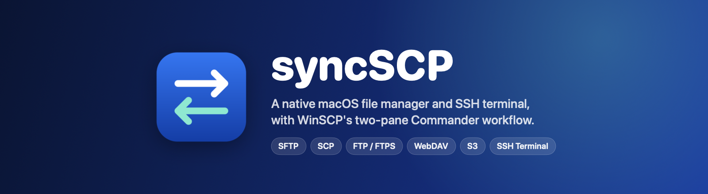
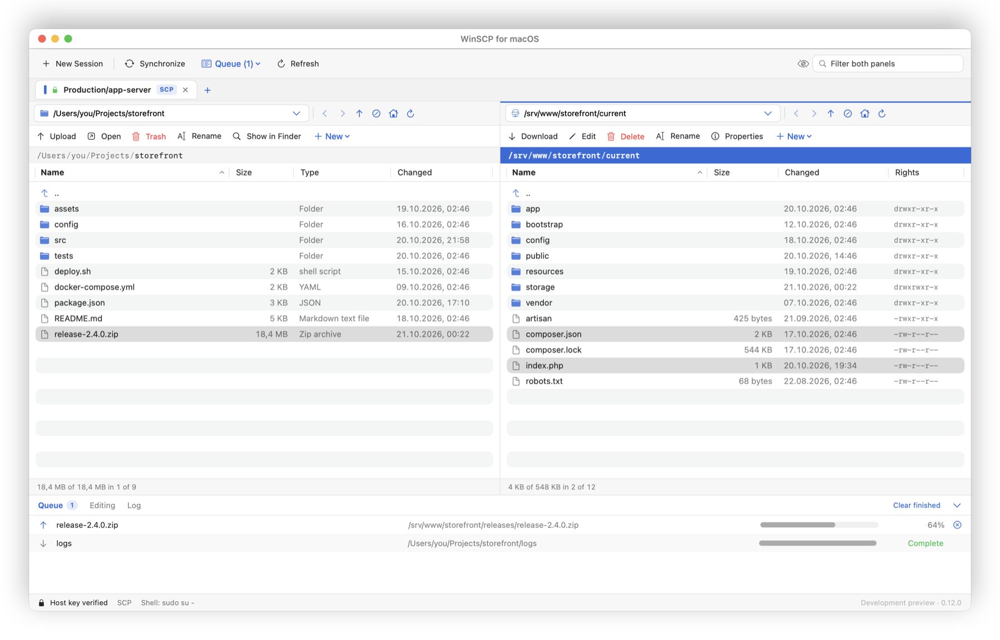
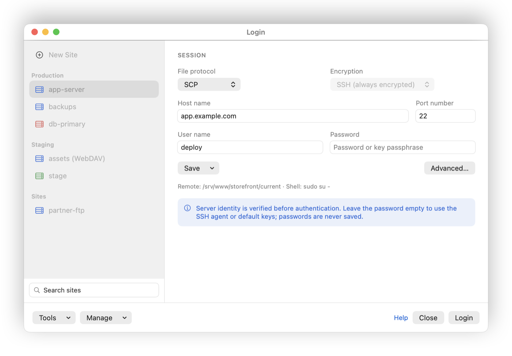
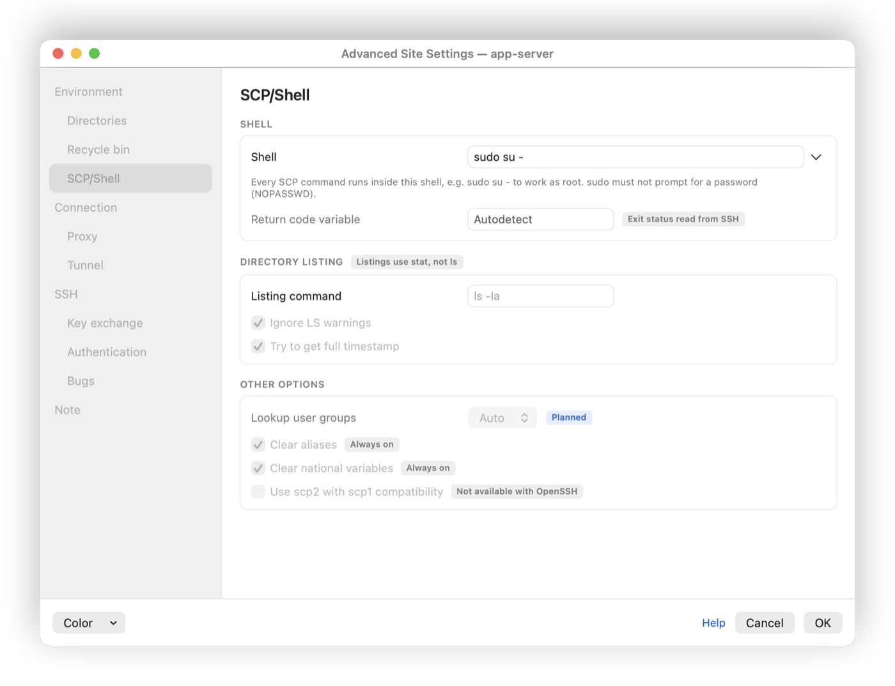
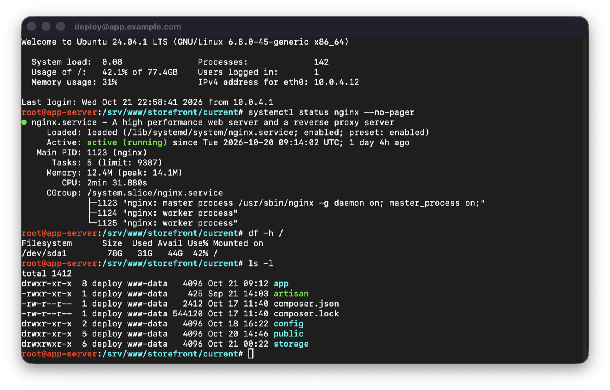
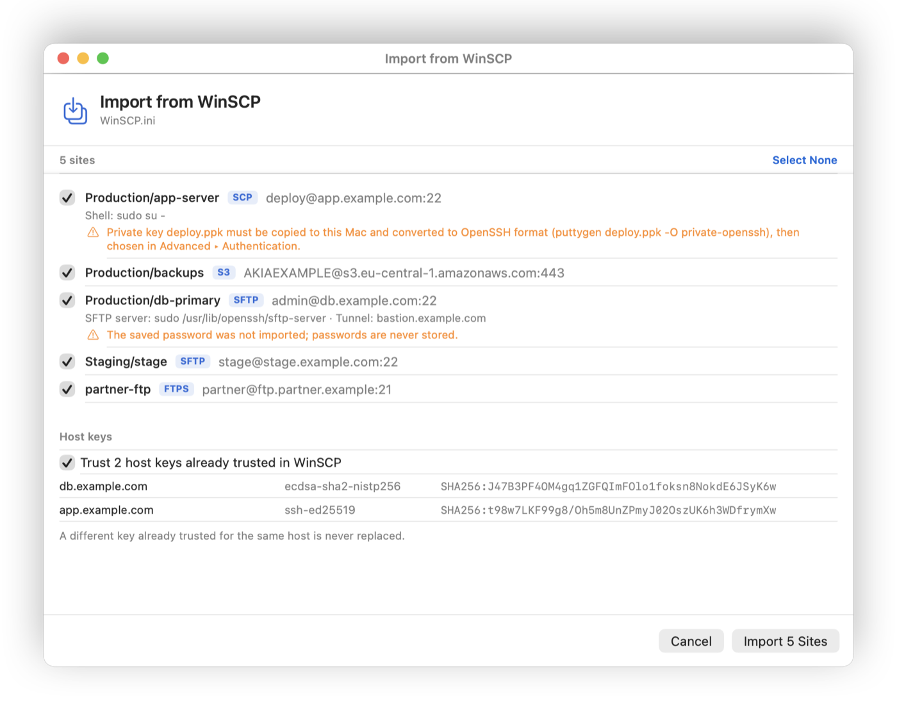
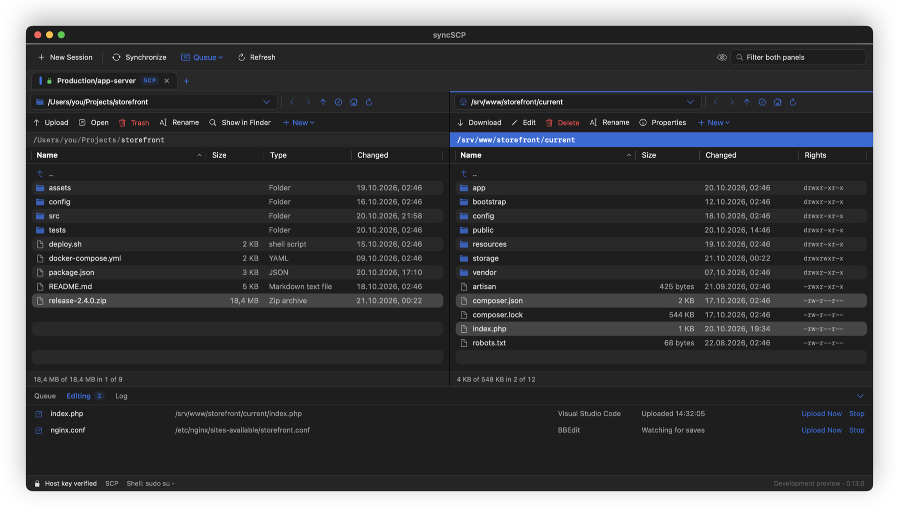

<a id="top"></a>

<p align="center">
  
</p>

<p align="center">
  <strong>SFTP, SCP, FTP/FTPS, WebDAV ve S3 için yerel bir macOS dosya yöneticisi ve SSH terminali</strong>
</p>

<p align="center">
  <a href="#-özellikler">Özellikler</a> &bull;
  <a href="#-ekran-görüntüleri">Ekran görüntüleri</a> &bull;
  <a href="#-kurulum">Kurulum</a> &bull;
  <a href="#-derleme">Derleme</a> &bull;
  <a href="#-testler">Testler</a> &bull;
  <a href="#-katkı">Katkı</a> &bull;
  <a href="#-lisans">Lisans</a> &bull;
  <a href="README.md">English</a>
</p>

<p align="center">
  
  
  
  
  <a href="LICENSE"></a>
  
</p>

<p align="center">
  Ücretsiz ve açık kaynak; WinSCP kullanıcılarının bildiği çift panelli Commander düzeni, Mac'e özgü olarak.<br/>
  WinSCP sitelerinizi içe aktarın, sunucuları yan yana gezin, uzak dosyaları istediğiniz uygulamada düzenleyin ve baktığınız klasörde SSH terminali açın.
</p>

---

<p align="center">
  
</p>
<p align="center"><em>Yerel ve uzak panel yan yana: <code>sudo su -</code> üzerinden çalışan bir SCP oturumu ve kuyruktaki bir aktarım.</em></p>

---

## 🚀 Genel bakış

syncSCP, WinSCP'nin Commander iş akışını Mac'e getiren yerel bir macOS uygulamasıdır (SwiftUI ve AppKit): yerel ve uzak panel, aktarım kuyruğu, site başına Advanced ayarlar ve yerleşik SSH terminali. macOS ile gelen OpenSSH ve libcurl'ü kullanır, kendi sıkı host key deposunu tutar ve parolaları hiçbir zaman diske yazmaz. Hesap, abonelik veya telemetri yok.

> **Durum: 0.15.0 geliştirme önizlemesi.** syncSCP bağımsız bir projedir; eski adı "WinSCP for macOS" idi. WinSCP ile bağlantısı yoktur, WinSCP tarafından desteklenmez ve WinSCP'nin Windows kodunu derlemez; iş akışlarını yeniden uygular. Özellik eşitliğine ilerleme [özellik tablosunda](docs/PARITY.md) izlenir.

## ⚡ WinSCP'den geçenler için

| Özellik                                  | syncSCP                                         | WinSCP              |
| ---------------------------------------- | ----------------------------------------------- | ------------------- |
| Platform                                 | macOS 13+, yerel (Apple Silicon ve Intel)       | Windows             |
| Çift panelli Commander                   | Var                                             | Var                 |
| Oturum sekmeleri (birden fazla sunucu)   | Var                                             | Var                 |
| SFTP, SCP, FTP/FTPS, WebDAV, S3          | Var                                             | Var                 |
| SSH terminali                            | Yerleşik pencere veya Terminal.app              | PuTTY ile           |
| `sudo su -` üzerinden SCP                | Var, tek kalıcı shell                           | Var                 |
| Advanced Site Settings                   | Tüm sayfalar; çoğu ayar uygulanıyor ([ayrıntı](docs/SETTINGS.md)) | Var |
| WinSCP sitelerini, anahtarlarını, host key'lerini içe aktarma | Var (`WinSCP.ini`, `reg export`, Wine/Whisky) | — |
| Kaydedince yükleyen harici editörler     | Var                                             | Var                 |
| Eşitleme                                 | Tek yönlü, önizlemeli                           | Tek ve çift yönlü   |
| Betik / otomasyon                        | Henüz yok                                       | Var                 |
| Aktarımı sürdürme, paralel kuyruk        | Henüz yok                                       | Var                 |
| Lisans                                   | GPL-3.0-or-later                                | GPL-3.0             |

## ✨ Özellikler

### 📁 Commander

- WinSCP düzeni, macOS görünümüyle: ana araç çubuğu, panel başına gezinme ve işlem çubukları
- **Oturum sekmeleri**: aynı anda birden fazla sunucuya bağlanın; her sekme site renginde ve kendi uzak/yerel klasörüyle. Bir sekmedeki aktarım, siz başka sekmede çalışırken kendi bağlantısında sürer (geçiş ⌘⇧] / ⌘⇧[, Duplicate Session ⌘⌥D)
- Üst klasör menülü yol alanı, geri/ileri geçmişi, tıklanabilir yol şeridi ve ".." satırı
- Yerelde Name/Size/Type/Changed, uzakta Name/Size/Changed/Rights sütunları ve WinSCP'nin "0 B of 34.9 MB in 0 of 40" özeti
- Paneller arasında ve Finder'dan sürükle-bırak; aynı kuyruk ve üzerine yazma soruları
- Commander tuşları (F2 yeniden adlandır, F4 düzenle, F5 diğer panele kopyala, F7 klasör, F8 sil) ve Go menüsü (⌘[ ⌘] ⌘↑ ⌘⇧H ⌃⇥)
- İki panelde de New ▸ Folder… ve New ▸ File…; site başına son klasör hatırlanır
- Çoklu seçim, sıralama, gizli dosyalar ve filtre

### 💻 SSH terminali

- Session ▸ **Open Terminal** (⌘T), bağlı siteye ayrı bir pencerede etkileşimli SSH girişi açar
- Uzak panelde açık klasörde başlar; SCP shell ayarı (örneğin `sudo su -`) varsa onun üzerinden
- Dosya oturumuyla aynı Advanced ayarlar, proxy, tunnel ve sıkı `known_hosts` kontrolü
- Parola, anahtar parolası ve sudo soruları terminalin içinde sorulur; hiçbiri saklanmaz
- **Open in Terminal.app** (⌘⇧T) aynı girişi macOS Terminal'de açar
- İstediğiniz monospace font (ikonlu prompt'lar için Nerd Font dahil); açık/koyu temaya uyar; Option tuşu @ ve | gibi karakterleri yazar

### 🌐 Protokoller

- **SFTP v3**, `/usr/bin/ssh` üzerinden; ilk bağlantıda parmak izi onayı, sonrasında sıkı doğrulama
- **SCP**, paylaşılan OpenSSH kanallarıyla; hızlı gezinme için kalıcı shell ([gereksinimler](docs/SCP.md))
- **FTP, explicit ve implicit FTPS**, macOS libcurl ile: iki kanalda TLS, sertifika zinciri ve hostname doğrulaması, isteğe bağlı özel CA ([ayrıntı](docs/FTP.md))
- **HTTP/HTTPS üzerinden WebDAV**: PROPFIND, koleksiyonlar, MOVE/DELETE, ETag koşullu değiştirme ([ayrıntı](docs/WEBDAV.md))
- **S3 ve S3 uyumlu depolama**: SigV4 imzalı içerik, sayfalı listeleme, multipart yükleme, koşullu yazma, sunucu tarafı kopyayla yeniden adlandırma ([ayrıntı](docs/S3.md))

### 🔄 Aktarım ve düzenleme

- Dosya ve alt klasörlerle birlikte yükleme/indirme; ilerleme, iptal ve iş başına sonuç gösteren kuyruk
- Aktarımlar geçici `.filepart` yoluna yapılır ve yalnızca tamamlanınca yerine konur; üzerine yazmadan önce her zaman sorulur
- **Edit With** ile istediğiniz uygulama: her kayıt yüklenir, ama sunucudaki kopya açtığınız sürümse
- Hızlı değişiklikler için yerleşik UTF-8 editör, çakışma kontrolüyle
- Önizlemeli, tek yönlü yerel → uzak eşitleme; uzakta hiçbir şey silinmez

### 🧭 Siteler ve ayarlar

- WinSCP tarzı Login: klasörlü site ağacı, arama, ayrı protokol ve şifreleme seçimi, Save / Save As… ve Manage
- WinSCP'nin **Advanced Site Settings** penceresi sayfa sayfa: SCP/Shell, SFTP server, zaman aşımı, keepalive, IPv4/IPv6, SOCKS/HTTP/yerel proxy, SSH tunnel, TLS sürümleri, cipher ve key exchange sıralaması, rekey, kimlik doğrulama, S3 seçenekleri, not ve renk. macOS'ta uygulanamayan seçenekler gerekçesiyle pasif gösterilir ([ayrıntı](docs/SETTINGS.md))
- **WinSCP'den içe aktarma**: `WinSCP.ini`, `reg export` dosyası ya da bu Mac'te Wine, Whisky veya CrossOver altında çalışan WinSCP. Siteler klasörleri ve ayarlarıyla gelir, şifresiz PuTTY anahtarları OpenSSH'a çevrilir, güvenilen host key'ler eklenir ve önce yedek alınır ([ayrıntı](docs/IMPORT.md))

### 🔐 Güvenlik ve gizlilik

- Host key'ler uygulamanın kendi `known_hosts` dosyasında; değişen anahtar reddedilir, güvensiz atlama yok
- SSH config okuma, yönlendirme ve yerel komutlar kapalı (`-F /dev/null`)
- Parolalar site dosyalarına yazılmaz; SSH parolası yalnızca bağlantı denemesi süresince Keychain'de durur
- Her şey Mac'inizde kalır: `~/Library/Application Support/SyncSCP`

## 📸 Ekran görüntüleri

|                         Login                                 |                 Advanced Site Settings                         |
| :-----------------------------------------------------------: | :------------------------------------------------------------: |
|  |  |
| _Klasörlü siteler, protokol ve şifreleme seçimi_              | _WinSCP'nin tüm ayar sayfaları_                                |

|                      SSH terminali                            |                  WinSCP'den içe aktarma                        |
| :-----------------------------------------------------------: | :------------------------------------------------------------: |
|  |  |
| _Uzak klasörde, sitenin shell'i üzerinden açılır_             | _Siteler, ayarlar, PuTTY anahtarları ve host key'ler_          |

<p align="center">
  
</p>
<p align="center"><em>Koyu temada harici editörler: her kayıt, sunucudaki kopya değişmediyse yüklenir.</em></p>

<p align="center"><sub>Ekran görüntüleri örnek veriler içerir.</sub></p>

## 📥 Kurulum

Henüz yayımlanmış sürüm yok. Uygulamayı kaynaktan derleyin (aşağıda) ya da `./scripts/package-release.sh` ile üretilen ZIP'i kullanın.

Uygulama ad-hoc imzalıdır; Developer ID imzası ve notarization henüz yok. macOS kopyalanmış ya da indirilmiş bir derlemeyi engellerse sağ tıklayıp **Open** seçin veya şunu çalıştırın:

```bash
xattr -dr com.apple.quarantine /Applications/syncSCP.app
```

### Gereksinimler

- macOS 13 Ventura veya üstü, Apple Silicon ya da Intel
- SFTP, SCP ve terminal için sunucularınıza SSH erişimi
- S3 için access key ve secret key

### "WinSCP for macOS"tan geçiş

syncSCP ilk açılışta `~/Library/Application Support/WinSCPMac` klasörünü (siteler, `known_hosts`, çevrilmiş anahtarlar, düzenlemeler, yedekler) `~/Library/Application Support/SyncSCP` altına kopyalar ve kayıtlı anahtar yollarını günceller. Eski klasör yedek olarak kalır; her şey yolundaysa kendiniz silebilirsiniz. Varsayılan harici editör ayarı da taşınır.

## 🔨 Derleme

macOS 13+ ve Swift 5.9 veya üstü içeren bir Xcode araç zinciri gerekir. Homebrew kütüphanesi, Wine veya Electron yok; indirilen tek paket sürümü sabitlenmiş SwiftTerm.

```bash
git clone https://github.com/oguzhankrcb/syncSCP.git
cd syncSCP

# Birim testleri, ardından gerçek yerel SFTP/SCP sunucuları
./scripts/swift.sh test
./scripts/test-ssh.sh

# Uygulamayı derleyip açın
./scripts/build-app.sh
open dist/syncSCP.app
```

- `./scripts/build-app.sh --debug` geliştirme derlemesi; `--universal` Apple Silicon + Intel derlemesi üretir.
- `./scripts/package-release.sh` universal uygulamayı derler ve `dist/` altına doğrulanmış, sürüm numaralı uygulama ve kaynak ZIP'leri yazar.
- `Package.swift` dosyasını Xcode'da açıp `SyncSCP` şemasını da çalıştırabilirsiniz.

## 🧪 Testler

`./scripts/swift.sh test`; codec, ayar, içe aktarma, eşitleme ve depolama testlerini ve Apple'ın gerçek `/usr/libexec/sftp-server`'ına karşı SFTP testlerini çalıştırır. Entegrasyon testleri geçici yerel klasörler kullanır; SSH hesabınıza veya herkese açık bir sunucuya hiç dokunmaz.

SFTP + SCP + FTP + FTPS + WebDAV + S3 + terminal paketinin tamamı için yalnızca testte kullanılan izole bağımlılıkları kurun (Python 3.11+), MinIO S3 fixture'ı için Docker'ı başlatın ve çalıştırın:

```bash
./scripts/setup-protocol-tests.sh
./scripts/test-ssh.sh --all
./scripts/test-ssh.sh --all -c release
```

- **SSH:** `127.0.0.1` üzerinde geçici anahtarlar ve yetkisiz sunucular. SCP'nin SFTP'ye düşmediğini kanıtlayan yalnızca SCP sunucusu, sahte bir `sudo su -` shell'i ve terminal testleri için gerçek bir pseudo-terminal. SSH ayarlarınıza ve Remote Login'e dokunulmaz.
- **FTP/FTPS:** üretilmiş sertifikalarla pyftpdlib sunucuları: iki FTPS modu, eski listeleme biçimleri, izin hataları, iptal, güvenilmeyen sertifika, hostname uyuşmazlığı ve TLS düşürme denemesi.
- **WebDAV:** HTTP ve HTTPS üzerinde WsgiDAV/Cheroot: koşullu MOVE, kimlik doğrulama ve salt okunur hatalar, yönlendirmeler ve kısmi durum yanıtları.
- **S3:** digest ile sabitlenmiş imajdan iki localhost MinIO (HTTP ve HTTPS): multipart, koşullu yazma, yeniden adlandırma, iptal temizliği ve TLS güveni. Docker olmayan yerde `SYNCSCP_SKIP_S3=1` yalnızca S3'ü atlar.

Sürüm başına sonuçlar [docs/VERIFICATION.md](docs/VERIFICATION.md) dosyasında.

## 🛠 Teknolojiler

| Katman            | Teknoloji                                                           |
| ----------------- | ------------------------------------------------------------------- |
| Arayüz            | SwiftUI ve AppKit, yerel tablolar ve menüler                        |
| SSH, SFTP, SCP    | macOS OpenSSH (`/usr/bin/ssh`), kendi SFTP v3 codec'i               |
| FTP, WebDAV, S3   | Küçük bir C köprüsüyle macOS libcurl; SigV4 için CryptoKit          |
| Terminal          | [SwiftTerm](https://github.com/migueldeicaza/SwiftTerm) 1.20.0      |
| Kimlik bilgileri  | Keychain, yalnızca bağlantı denemesi süresince                      |
| Depolama          | Application Support altında JSON site deposu ve `known_hosts`       |
| Derleme           | Swift Package Manager, `lipo` ile universal binary                  |

## 🏗 Mimari

- **`SyncSCPCore`** protokolle ilgili her şeyi içerir: site modelleri ve depolama, protokolden bağımsız `RemoteSession`, sıralı çalışan SFTP/SCP/FTP/WebDAV/S3 istemcileri, OpenSSH süreç taşıması, WinSCP içe aktarma ve eşitleme planlayıcısı.
- **`SyncSCP`** uygulamanın kendisidir: Commander penceresi, giriş ve ayar pencereleri, host güveni, Keychain destekli askpass, kuyruk, editörler ve terminal pencereleri. `CommanderModel` main actor'da çalışır; bloklayan G/Ç onun dışında kalır.
- **`CCurlTransport`** sistem libcurl'üne giden küçük, özgün bir C köprüsüdür.

```
Sources/
  CCurlTransport/        # macOS libcurl için C köprüsü
  SyncSCPCore/           # Protokoller, siteler, içe aktarma, eşitleme (arayüzsüz)
    SFTPClient.swift       OpenSSH üzerinden SFTP v3
    SCPClient.swift        Eski SCP + kalıcı shell
    FTPClient.swift        libcurl ile FTP / FTPS
    WebDAVClient.swift     HTTP(S) üzerinden WebDAV
    S3Client.swift         SigV4 ile S3
    SSHTerminal.swift      Terminal için etkileşimli giriş
    WinSCPImport.swift     WinSCP.ini / reg / Wine içe aktarma
  SyncSCP/               # macOS uygulaması
    CommanderView.swift    Çift panelli Commander
    ConnectionSheet.swift  Login ve site yöneticisi
    AdvancedSiteSettings.swift
    TerminalWindow.swift   SwiftTerm terminal pencereleri
Tests/SyncSCPCoreTests/  # Birim ve gerçek sunucu entegrasyon testleri
scripts/                 # Derleme, paketleme ve test sunucuları
docs/                    # Mimari, eşitlik, ayarlar, doğrulama
```

Ayrıntılar [docs/ARCHITECTURE.md](docs/ARCHITECTURE.md) dosyasında (İngilizce).

## 🤝 Katkı

Katkılar memnuniyetle karşılanır. Lütfen önce ne değiştirmek istediğinizi bir issue'da konuşalım, sonra:

1. Repoyu fork'layıp bir dal açın: `git checkout -b feature/degisikligim`
2. Değişikliği testleriyle yapın; `./scripts/test-ssh.sh --all` çalıştırın
3. Neyi doğruladığınızı ve neyi doğrulamadığınızı yazarak pull request açın

Temel kurallar [CONTRIBUTING.md](CONTRIBUTING.md) dosyasında: sıkı host ve TLS doğrulaması, dizi tabanlı süreç argümanları, üzerine yazmayan aktarımlar ve dürüst doğrulama notları.

## 🐛 Sorun giderme

- İlk bağlantıda **"Trust this SSH server?"** sorulur. Güvenmeden önce parmak izini sunucu yöneticinizden aldığınızla karşılaştırın.
- **Host key verification failed:** sunucunun anahtarı, güvendiğinizden beri değişmiş. syncSCP bunu hiçbir zaman atlamaz; değişikliği doğrulayın, ardından eski satırı `~/Library/Application Support/SyncSCP/known_hosts` dosyasından silin.
- **SCP shell "did not start the command":** dosya oturumları için `sudo su -` parola sormadan çalışmalı (sudoers'ta `NOPASSWD`). Terminal ise sudo parolasını kendisi sorar.
- Terminalde **`sudo: unable to resolve host …`** sunucudan gelir: sunucunun kendi adı `/etc/hosts` içinde yok. sudo yine çalışır.
- **Terminalde ikonlar `?` görünüyor:** Settings ▸ Terminal'den bir Nerd Font seçin.
- **macOS uygulamayı engelliyor:** [Kurulum](#-kurulum) bölümüne bakın.

## 📄 Lisans

syncSCP'nin özgün kaynak kodu **GNU General Public License v3.0 veya sonrası** ile lisanslıdır; [LICENSE](LICENSE) ve [NOTICE.md](NOTICE.md) dosyalarına bakın. Hiçbir garanti verilmez.

## 🙏 Teşekkürler

- Martin Prikryl ve katkıcılarının geliştirdiği [WinSCP](https://winscp.net/)'den ([kaynak](https://github.com/winscp/winscp)) esinlenmiştir. syncSCP onun kodunu veya ikonlarını kullanmaz; incelenen sürüm [upstream/REFERENCE.md](upstream/REFERENCE.md) dosyasında kayıtlıdır.
- SSH için [OpenSSH](https://www.openssh.com/), FTP/WebDAV/S3 taşıması için [libcurl](https://curl.se/libcurl/); ikisi de macOS ile gelen sürümleriyle
- Terminal emülasyonu [SwiftTerm](https://github.com/migueldeicaza/SwiftTerm) (MIT)
- README düzeni [anySCP](https://github.com/macnev2013/anySCP)'den esinlenmiştir

---

<p align="center">
  syncSCP işinize yarıyorsa GitHub'da bir ⭐ vermeyi düşünün.
</p>

<p align="center">
  <a href="#top">Başa dön</a>
</p>
